# Tiny Refuel v0.2.3

**Nyt i 0.2.3:** valgfrie stations- og køretøjskort, favoritter, lokal prishistorik, særskilt opladningsoversigt, datastatus og stationer på Home Assistants indbyggede kort. Det eksisterende kort og dets opsætninger bevares. Se [de nye kort og paneler](docs/dashboards.md), [stationskort og historik](docs/station-cards.md) og [panel-eksemplet](examples/dashboards.yaml).

Benzin, diesel og opladning i Home Assistant – med eller uden køretøj. Tiny Refuel samler kort, visuel editor, selskabslogoer, køretøjskatalog og scraping i én HACS-integration.

## Installation

### HACS

Tiny Refuel kan installeres gennem [HACS](https://hacs.xyz/) (Home Assistant Community Store).

Brug knappen til at åbne Tiny Refuel direkte i HACS:

[](https://my.home-assistant.io/redirect/hacs_repository/?owner=Salvationdk&repository=tiny-refuel&category=integration)

*eller*

1. Installér HACS, hvis du ikke allerede har det.
2. Åbn HACS i Home Assistant.
3. Vælg **menuen med tre prikker → Brugerdefinerede repositories**.
4. Tilføj `https://github.com/Salvationdk/tiny-refuel` med typen **Integration**.
5. Søg efter **Tiny Refuel**, og tryk på **Download**.

### Opsætning efter download

1. Genstart Home Assistant.
2. Gå til **Indstillinger → Enheder og tjenester → Tilføj integration → Tiny Refuel**.
3. Vælg opdateringsinterval. Standard er hver 6. time.
4. Genindlæs browseren med **Ctrl+F5**.
5. Tilføj **Tiny Refuel** eller et af de valgfrie ekstra kort fra dashboardets kortvælger.

Køretøjskortene genbruger automatisk køretøjer fra eksisterende Tiny Refuel-kort på samme betjeningspanel, når der ikke er opsat fælles køretøjer. Dine eksisterende kortopsætninger bevares.

Kortvælgeren viser kompakte navne og beskrivelser for Tiny Refuel-kortene. Når du vælger et kort, kan du fortsat se dets forhåndsvisning i editoren.
6. Vælg selskaber, stationer, position eller fælles køretøjer i det valgte korts visuelle editor. Prisoversigt, stationskort, favoritter og opladning kræver ikke et køretøj.

Kort, editor, selskabslogoer, køretøjskatalog og scraper følger med integrationen. Kortets JavaScript indlæses automatisk.

Kortet kan også tilføjes med YAML:

```yaml
type: custom:tiny-refuel-card
vis_benzin: true
vis_diesel: false
vis_el: true
vis_andet: true
```

Første scraping starter automatisk i baggrunden og kan tage flere minutter. **Hent data** i kortet eller integrationens knap starter en fælles opdatering.

Under hentning viser kortet den aktuelle udbyder og, når stationer eller adresser behandles enkeltvis, den aktuelle station/adresse. Status dækker benzin, diesel og el. Datastatus viser hver brændstofkilde, antal stationer og priser, manglende koordinater, seneste kontrol og eventuelle fejl. Eloversigten viser tilsvarende kilde- og koordinatstatus. Gamle priser markeres som gemte, når seneste hentning fejler. Adresser uden koordinater tælles og behandles gradvist ved senere hentninger.

Kortet bruger samme listevisning, uanset om skærmen står eller ligger. Hvert kort beholder logo, priser, adresse og afstand. Farver, kundefordele, filtre, navigation og knappen **Vis 10 mere** bevares. I UI-editoren kan hele kortets YAML vises og kopieres.

Hent-knappen kan skjules under punktet **Hent data** i UI-editoren. Her kan du også begrænse en manuel hentning til det valgte køretøjs drivmiddel. Et benzindrevet køretøj henter benzin, et dieseldrevet køretøj diesel, et elkøretøj el og en plug-in-hybrid både benzin og el. Slås begrænsningen fra, hentes alle typer. Automatisk intervalhentning henter fortsat alle typer, så nye køretøjer også får data. Data for fravalgte typer bevares mellem hentninger. Nogle brændstofkilder leverer benzin- og dieselpriser samlet, så de kan stadig blive hentet sammen.

Brændstof- og elladekilder er opdelt i hver sit provider-modul. Fordele, apps, medlemsordninger, rabatter og bilvask hentes fra relevante officielle sider hos hver udbyder, højst én gang om ugen. Kortet samler korte beskrivelser fra flere sider, når det er relevant, og viser den officielle kilde og hentetid. Kundeanmeldelser, citater og kommentarer sorteres fra, og cachede tekster genhentes, når filtreringen ændres. Hvis en side ikke kan læses, beholdes seneste gemte oplysninger.

Hvis kortet ikke findes efter genindlæsning, kan denne ressource tilføjes manuelt under dashboardets ressourcer med typen **JavaScript-modul**:

```text
/tiny_refuel/static/tiny-refuel-card.js?v=0.2.3
```

## Vælg de kort, du har brug for

Det eksisterende kort og dets gemte opsætninger bevares. De nye kort er valgfrie og kan tilføjes flere gange på samme eller forskellige betjeningspaneler. Alle har visuel editor; ingen ekstra kortudvidelser er nødvendige.

| Kort i kortvælgeren | Type | Brug |
|---|---|---|
| Tiny Refuel | `custom:tiny-refuel-card` | Det eksisterende samlede kort med køretøjer, priser, opladning og fordele |
| Tiny Refuel · Prisoversigt | `custom:tiny-refuel-prices-card` | Stationspriser uden køretøj; søgning, drivmiddel, selskaber, radius og sortering |
| Tiny Refuel · Station | `custom:tiny-refuel-station-card` | Én station med priser, navigation og lokal prishistorik |
| Tiny Refuel · Favoritter | `custom:tiny-refuel-favorites-card` | Selvvalgte stationer, gemt sammen med kortets opsætning |
| Tiny Refuel · Mine køretøjer | `custom:tiny-refuel-vehicles-card` | Fælles køretøjer med nærmeste relevante steder og beregnet pris for hele kapaciteten |
| Tiny Refuel · Prissammenligning | `custom:tiny-refuel-comparison-card` | Enhedspris, afstand, hel kapacitet og merpris for samme drivmiddel |
| Tiny Refuel · Køretøjsoplysninger | `custom:tiny-refuel-vehicle-details-card` | Model, årgang, variant, kapacitet og tilgængelig kontrolstatus/kilder |
| Tiny Refuel · Opladning | `custom:tiny-refuel-charging-card` | Lokale ladesteder og særskilte generelle selskabstakster |
| Tiny Refuel · Datastatus | `custom:tiny-refuel-status-card` | Kilder, fejl, kataloger, historik og kortmarkører samt start af datahentning |

En positionsenhed er kun nødvendig for afstand/radius og nærmeste sted. Afstand er i luftlinje. Prissammenligningen blander ikke liter og kWh. Uden kapacitet vises enhedspriser uden en opdigtet total; beregningen for en hel tank eller batterikapacitet medregner ikke aktuelt indhold, ladetab eller gebyrer. Generelle selskabstakster fremstår særskilt fra lokale stationspriser.

### Prishistorik

Prisændringer gemmes lokalt fra aktivering. Standard er **90 dage**; vælg **0–365 dage** under integrationens **Konfigurer → Opdateringsinterval**. 0 stopper registrering og visning, men sletter ikke en eksisterende database. Én tidligere observation pr. station/drivmiddel bevares som udgangspunkt for uændrede priser. Fejlramte gemte priser og generelle selskabstakster bliver ikke registreret som aktuelle lokale prisændringer.

Åbn **Prishistorik** i stationskortet for graf, periodevalg og de seneste observationer. Ældre priser kan ikke hentes bagud uden en historisk kilde. Historikken gemmer ikke køretøjer eller brugerpositioner. Se [stationskort og historik](docs/station-cards.md).

### Stationer på Home Assistants indbyggede kort

Aktivér under **Indstillinger → Enheder og tjenester → Tiny Refuel → Konfigurer → Stationer på HA-kortet**. Vælg selskaber, radius, eventuelle bestemte stationer og højst **250 markører**. Funktionen er slået fra som standard. Uden positionsenhed bruges HA’s hjemmeplacering; en valgt utilgængelig positionsenhed giver ingen markører.

Tilføj et indbygget **Kort** og vælg den geografiske kilde **tiny_refuel**. Kun fysiske steder med koordinater får markører. Priser, adresse, ladeform, hentetid og aktualitet kan ses på entiteten. HA styrer selv kortets design.

```yaml
type: map
title: Stationer
geo_location_sources:
  - tiny_refuel
```

### Flere betjeningspaneler

Byg eksempelvis **Priser**, **Opladning**, **Mine køretøjer** og **Datastatus** ved at tilføje kortene gennem UI. [Panel-eksemplet](examples/dashboards.yaml) indeholder alle fire visninger til et nyt betjeningspanel. Vælg derefter stationer, favoritter og køretøjer i editorerne. Eksisterende paneler overskrives ikke. Se [den samlede vejledning](docs/dashboards.md).

## Skærmbilleder fra 0.2.3

Billederne kommer fra en rigtig Home Assistant 2026.10-installation og Chromium. Priser, køretøjer, ladesteder og position er fiktive testdata. Den visuelle kontrol består med **110 skærmbilleder** på computer og mobil i lyst og mørkt tema. Her er et udvalg; billederne ligger i repository og udløber ikke som workflow-artifacts. Hele kørslen findes under [Visual Home Assistant](https://github.com/Salvationdk/tiny-refuel/actions/runs/39447222908). Se [testvejledningen](docs/visual-testing.md).

| Det oprindelige kort | Kompakt på mobil |
|---|---|
| 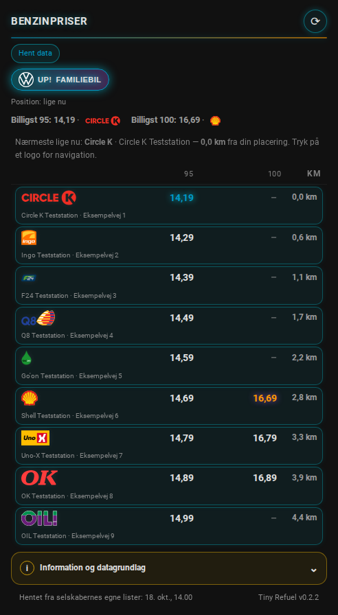 | 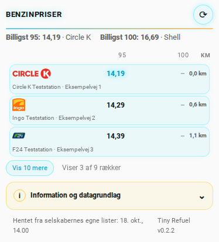 |

| Prisoversigt uden køretøj | Selvvalgte favoritstationer |
|---|---|
| 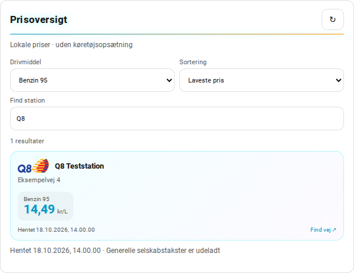 | 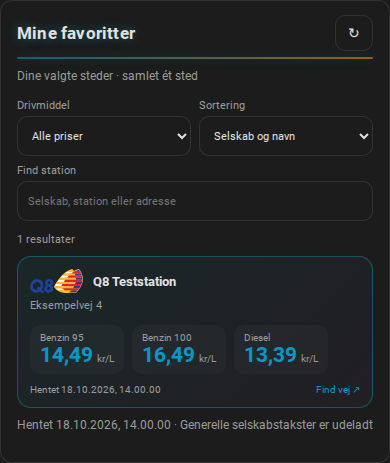 |

| Stationskort og prishistorik | Prishistorik på mobil |
|---|---|
| 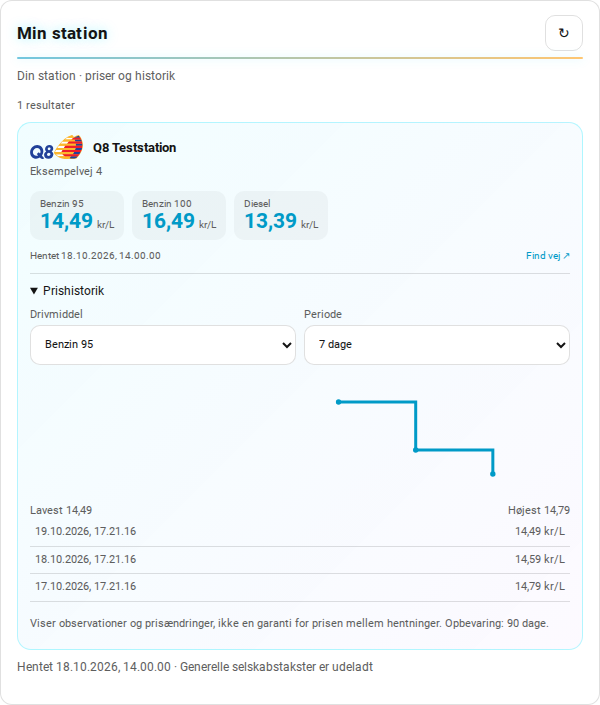 | 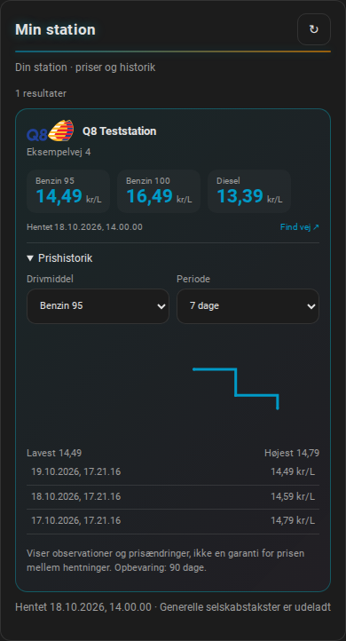 |

| Mine køretøjer | Prissammenligning |
|---|---|
| 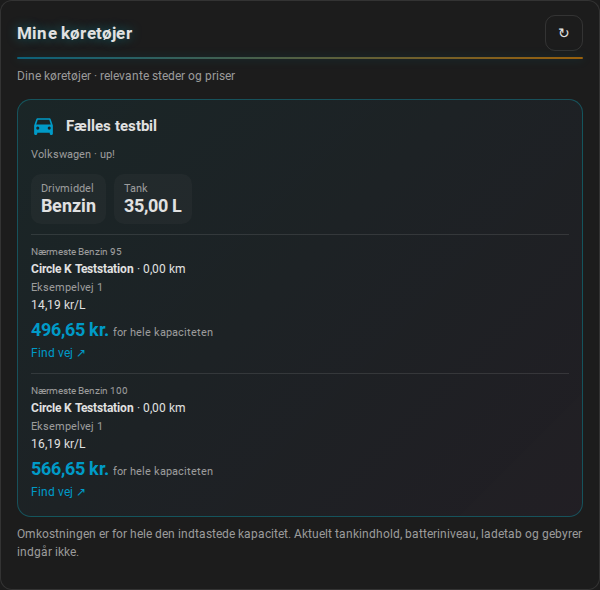 | 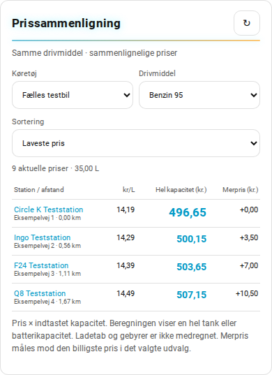 |

| Køretøjsoplysninger | Opladning: lokale priser og generelle takster |
|---|---|
| 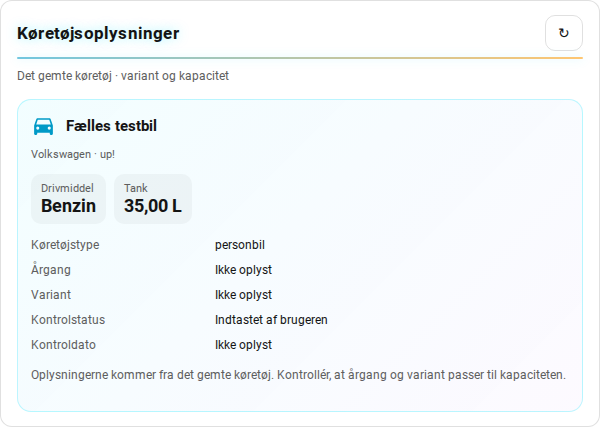 | 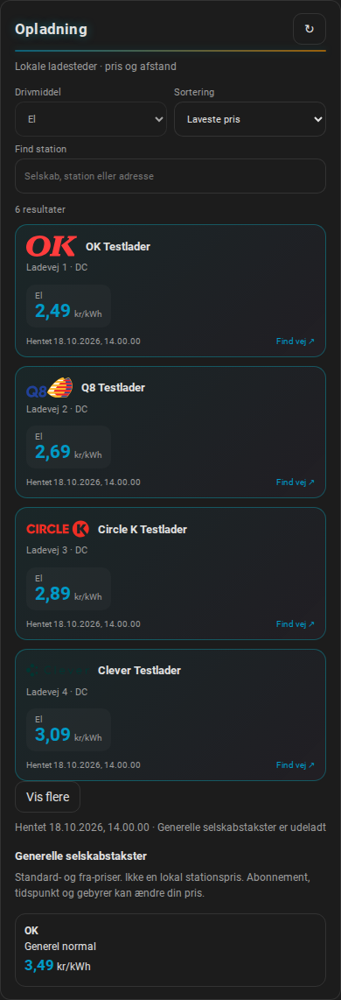 |

| Datastatus | Stationer på HA’s indbyggede kort |
|---|---|
| 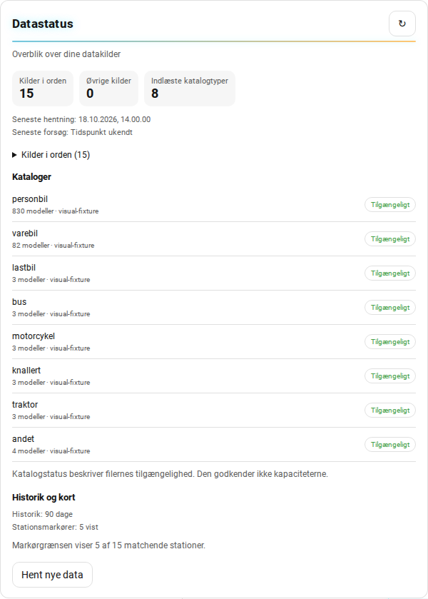 | 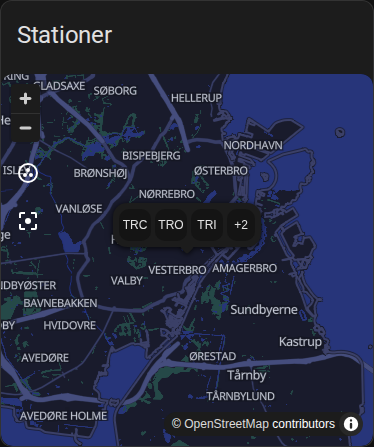 |

| Visuel editor: prissammenligning | Visuel editor: opladning |
|---|---|
| 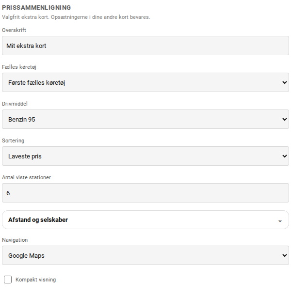 | 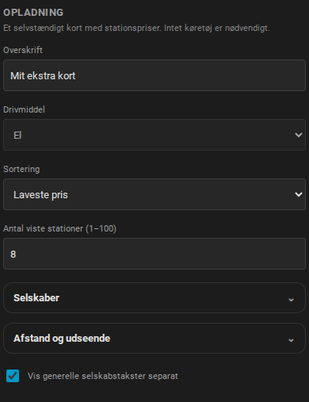 |

| Visuel editor: stationer og favoritter | Visuel editor: køretøj |
|---|---|
| 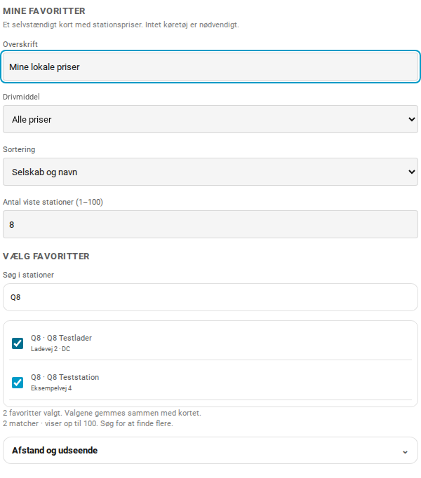 | 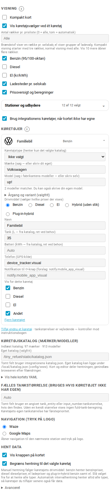 |

| Editor: selskaber og udbydere | Information og datagrundlag |
|---|---|
| 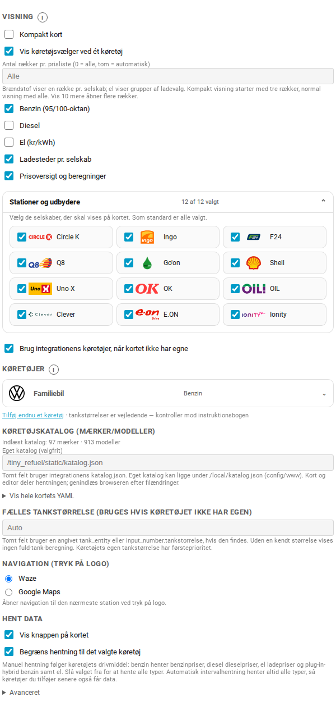 | 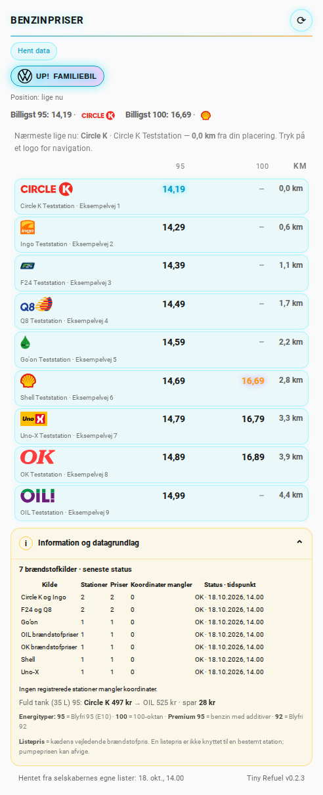 |

| Plug-in-hybrid i det oprindelige kort | Oprindelig ladeoversigt på mobil |
|---|---|
| 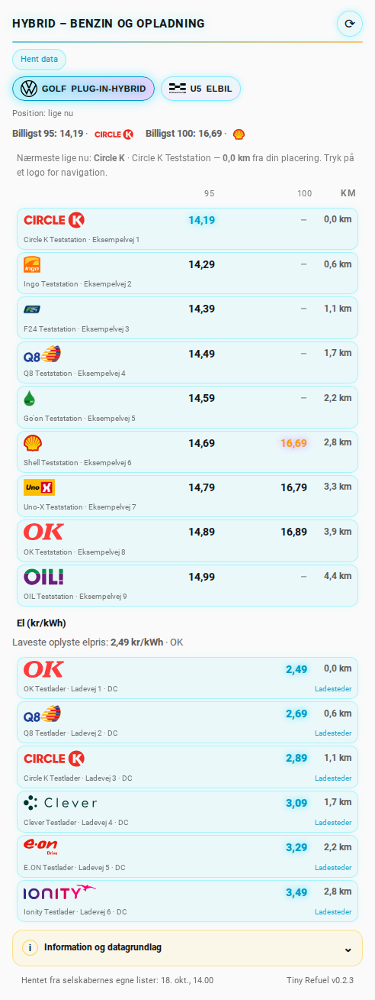 | 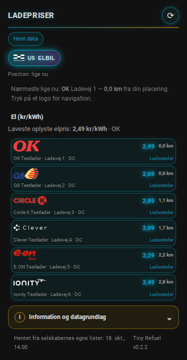 |

| Popup med ladesteder | Kildefejl med gemte data |
|---|---|
| 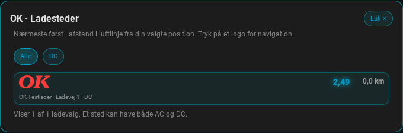 | 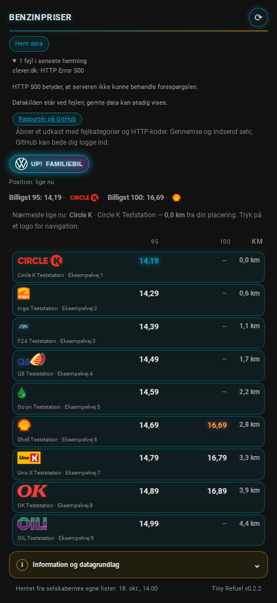 |

| Home Assistants korteditor | Integrationens entiteter |
|---|---|
| 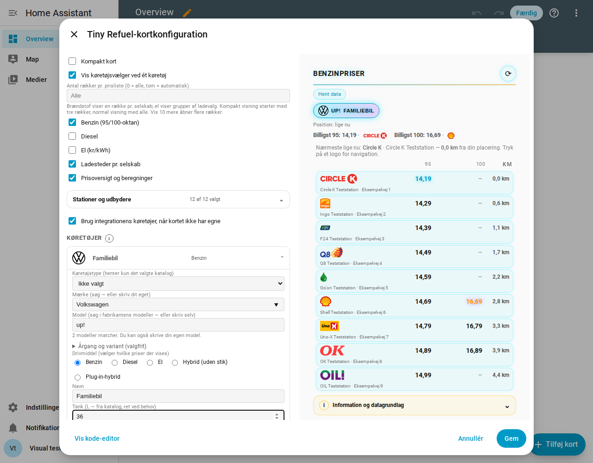 | 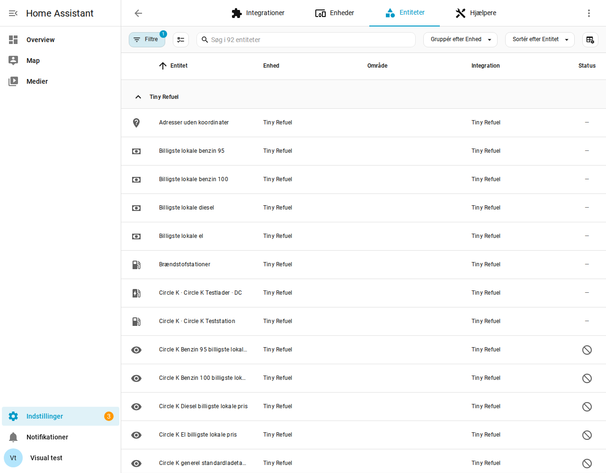 |

| Integrationens indstillinger | Årgang, variant og kapacitet |
|---|---|
| 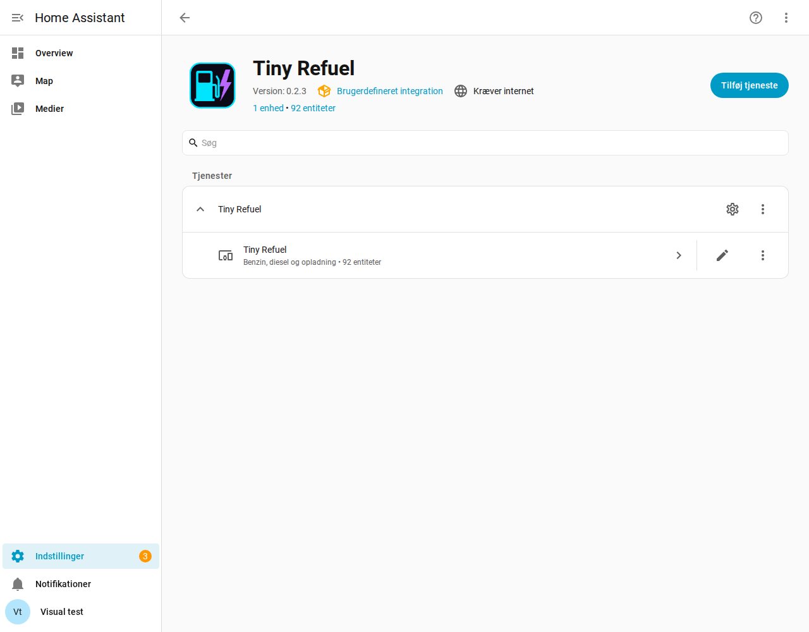 | 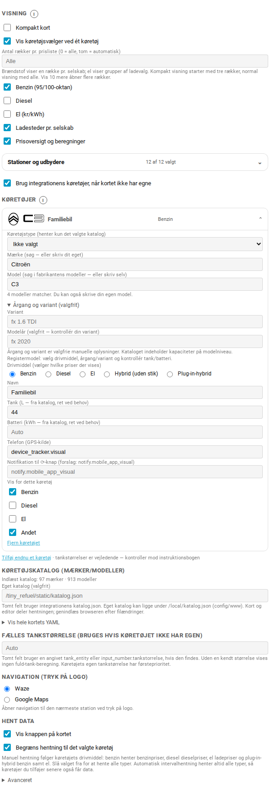 |

De nye og eksisterende kort deler tema, farver og logoer. HA’s indbyggede kort bruger Home Assistants eget markør- og kortdesign. Den visuelle test kontrollerer også åbning, gemning og genåbning af det oprindelige kort gennem Home Assistants korteditor.

Et køretøj kan udvides for at vælge mærke, model, drivmiddel, tank eller batteri, positionsenhed og hvilke energityper der skal vises. Det medfølgende fallback-katalog rummer 913 modeller fordelt på 97 mærker i én `katalog.json` uden variantinventarer. Kun modeller med en kendt positiv tank- eller batteristørrelse medtages; motorredskaber og selvbyg er udeladt. En kapacitet på modelniveau bekræfter ikke alle årgange eller varianter. Egne køretøjer kan stadig indtastes manuelt. Ved mærke-/modelskift ryddes afhængige felter og tidligere automatisk dannede navne; selvvalgte navne bevares. Årgang og variant er valgfrie manuelle oplysninger i et sammenklappeligt afsnit; standardkataloget bruges til tank-/batteristørrelse. Egne kataloger kan tilføje årgangsdata.

Logopuljen er klargjort til 281 mærkenavne: 261 indlejrede SVG-logoer og 20 PNG-fallbacks. 16 SVG’er er gennemgåede vektoriseringer af rasterkilder, ikke originale vektorudgaver. Kilder og konverteringer er dokumenteret. Logoerne bruges i både editor og køretøjsknapper, også til manuelt indtastede køretøjer. Katalogets mærke- og modelfelter har søgning med højst 60 synlige forslag. Køretøjstype filtrerer både mærke- og modelforslag efter modellens `vehicle_types`. Mærker med flere typer viser kun de relevante modeller. Kataloget indeholder også lastbiler, busser, motorcykler, knallerter, traktorer og andre motorkøretøjer. Typer uden dokumenterede modeller i et eget katalog giver ingen katalogforslag. Eget mærke og model kan stadig indtastes manuelt. Kategorierne beskriver modelfamilier, ikke registreringsklassen for den enkelte bil. Modelværdier bekræfter ikke alle årgange eller motorvarianter. Se [logodokumentationen](docs/vehicle-logos.md).


## Funktioner

- Benzin, diesel og EL efter valgt køretøj.
- Hybrid uden stik viser benzin; plug-in-hybrid viser benzin og opladning.
- Adresser og nærmeste sted med afstand i luftlinje.
- Navigation gennem Waze eller Google Maps ved tryk på selskabets logo.
- **Ladesteder** pr. selskab med nærmeste først og relevante AC/DC/Normal/Hurtig/Lyn-filtre.
- 10 ladevalg ad gangen med mulighed for at vise flere.
- Q8 samlet i én EL-celle.
- Generelle OK/Q8-takster vises særskilt fra konkrete lokale priser.
- **Fordele** med vilkår, hvor der findes relevante oplysninger.
- Antal unikke ladesteder, selskaber og steder med konkret lokal elpris.
- Én opdateringshandling for alle kilder.
- Gentagne klik deler den igangværende hentning.
- Sensorer for lokale priser på 95, 100, diesel og el, stationstal, hentetid, fejl og koordinatstatus.
- Knapper til alle data, benzin, diesel eller el samt handlingen `tiny_refuel.refresh`.

AC og DC på samme sted tælles én gang pr. selskab. Generelle selskabstakster tæller ikke som lokale priser. Medlemsrabat trækkes ikke automatisk fra priserne.


## Sensorer og fælles køretøjer

De tre eksisterende sensorers identitet bevares. Integrationens nye entiteter kan bruges i almindelige Home Assistant-kort, historik og automationer:

| Entiteter | Datagrundlag |
|---|---|
| Billigste og gennemsnitlige lokale 95-, 100-, diesel- og kWh-pris | Aktuelle lokale priser i hele udtrækket. Listepriser, generelle selskabstakster og fejlramte gemte rækker udelades. Uden brugbare priser bliver værdien ukendt. Det gælder også, hvis hele hentningen fejler; tidligere data bevares til fejlsøgning. |
| Antal brændstofstationer, ladesteder og steder med lokal elpris | Stationer og ladesteder i installationens data |
| Seneste hentning, antal fejl og adresser uden koordinater | Hentningens status, inklusive fejl fra kundefordele |
| Hentning i gang og datakildefejl | Binære sensorer til status og automationer |
| Valgfrie sensorer pr. selskab | Billigste lokale priser, generelle standardladetakster og kildestatus. Aktivér dem under integrationens entiteter efter behov. |
| Katalogstatus | Indlæste typer, versioner, modelantal og eventuel brug af gemte kopier. Status godkender ikke modellernes kapaciteter. |
| Valgfrie stationsmarkører | Fysiske steder med koordinater på HA’s indbyggede kort, afgrænset i integrationens indstillinger. |
| Fire henteknapper | Alle data, benzin, diesel eller el. Samtidige kald deler den igangværende hentning. |

De generelle standardladetakster vises særskilt fra lokale priser. Standard er OK/Q8 Normal, E.ON AC, Circle K Lyn og IONITY direkte betaling. Taksterne kan være fra-priser og kan afvige fra den lokale pris. Sensorens attributter viser de øvrige offentliggjorte takster. Ved kildefejl bevares taksterne som gemte oplysninger; den aktuelle numeriske værdi er ukendt.

Opret fælles køretøjer under **Indstillinger → Enheder og tjenester → Tiny Refuel → Konfigurer → Tilføj fra katalog** eller **Tilføj manuelt**. Vælg type, mærke, model og eventuel variant fra kataloget, eller indtast køretøjet manuelt. Kontrollér kapaciteten for årgang/variant, og angiv eventuelt en positionsenhed. Mærke, model og notifikationsservice er valgfrie. Samme menu kan ændre intervallet og redigere eller fjerne køretøjer.

Hvert fælles køretøj får sensorer for nærmeste relevante station, afstand i luftlinje, lokal pris på stedet og beregnet fuld tank/opladning. Et benzinkøretøj får 95 og 100; diesel får diesel; el får opladning; plug-in-hybrid får benzin og opladning. Hvis nærmeste ladested mangler lokal pris, kan station og afstand stadig vises, mens pris og opladningsbeløb er ukendte. Der antages ingen tankstørrelse. Beregninger bruger hele kapaciteten og medregner ikke ladetab, rabatter, abonnementer eller ekstra gebyrer.

Kort uden egne `biler` bruger automatisk integrationens fælles køretøjer. Det kan fravælges i editoren med **Brug integrationens køretøjer, når kortet ikke har egne** (`brug_faelles_koeretoejer: false`). Eksisterende køretøjer i kortets YAML har prioritet og flyttes ikke automatisk. Køretøjssensorerne følger de fælles køretøjer og ændres ikke, når en bruger vælger et andet køretøj eller andre filtre i et enkelt kort. Globale prissensorer følger heller ikke kortets selskabsfiltre.

Køretøjernes sensoridentiteter bevares ved navneændringer. Ved fjernelse af et fælles køretøj slettes dets sensorentiteter. Den valgte positionsenhed bruges lokalt i Home Assistant til sensorerne; den sendes ikke til prisudbyderne.

## Fejl og rapportering

Åbne informations- og fejlfelter bevares ved automatiske opdateringer. Åbnes et andet informationsfelt, lukkes det foregående. Ladeoversigten bliver åben, indtil du trykker **Luk** eller åbner en anden ladeoversigt.

Fejloversigten viser også fejl ved hentning af officielle kundefordele og ved kontakt til integrationens data-API. Fordele hentes normalt højst én gang om ugen; tidligere brugbare oplysninger bevares ved kildefejl. Kortets afslutningsstatus tæller også fordelsfejl med.

HTTP 500 betyder en intern fejl hos den server, der besvarer kaldet. Udbyderfejl og fejl fra Home Assistants data-API vises med hver sin kilde. Offentlige GET-kald forsøges én gang igen efter en kort pause ved HTTP 500, 502, 503 eller 504. En vedvarende fejl vises stadig; genforsøget gælder ikke 403, 404 eller 429.

**Rapportér på GitHub** åbner et issueudkast med Tiny Refuel-version, kendte kildebetegnelser, fejlkategorier og HTTP-koder. Rå fejltekster, adresser, positioner, køretøjer og Home Assistant-konfiguration indsættes ikke i udkastet. Brugeren gennemser og indsender selv; GitHub beder om login, hvis nødvendigt. Integrationens kode registrerer ikke, om brugeren allerede er logget ind på GitHub.

## Datakilder

Kun frit tilgængelige kilder uden betalt eller registreret API-adgang bruges.

| Selskab | Oplysninger fra anvendt kilde |
|---|---|
| Circle K / INGO | Offentlige brændstofpriser; Circle K også danske ladesteder, stiktyper, effekt og daglig listepris for lynladning |
| Q8 / F24 | Stationspriser inklusive HPC, når oplyst; Q8's generelle ladetakster vises særskilt |
| Go'on / Shell / Uno-X | Offentlige brændstofkilder; Shell og Uno-X også ladesteder |
| OK / OIL | Lokale brændstofpriser og ladeadresser; generelle OK-ladetakster særskilt |
| Clever | Ladesteder, adresser, koordinater og AC/DC/effekt, når oplyst. Prisen varierer pr. sted og tidspunkt og skal ses i Clever-appen/kortet |
| E.ON | Ladesteder, adresser, koordinater og AC/DC/effekt, når oplyst; offentlige danske startpriser vises som generelle takster |
| IONITY | Aktive danske steder, koordinater og effekt/antal, når oplyst; ingen gadeadresse i udtrækket. Offentlige minimumspriser for app, direkte betaling og abonnement vises særskilt |

Ved vellykket hentning erstattes selskabets tidligere liste. Ved kildefejl bevares eventuelle tidligere data fra denne installation, tydeligt markeret som gemte data.

En downloaddato er ikke en garanti for selskabets egen kontroltid. En hentning kan give data fra nogle selskaber og fejl fra andre; fejlene vises i kortet.

Adressekoordinater, der ikke findes i selskabets kilde, kan slås op med Nominatim, maksimalt 30 nye adresser pr. kørsel samlet for brændstof- og ladestationer i de hentede drivmidler. Det er stationsadresser, ikke din GPS-position.

Under **Information og datagrundlag** skelnes mellem unikke adresser klar til opslag, adresser søgt uden resultat og stationer uden en adresse at søge på. Seneste kørsel viser forsøg, fund, manglende resultater og fejl. De konkrete adresser og første mulige genforsøg vises i en liste. Adresser uden søgeresultat prøves tidligst igen efter syv dage; netværksfejl stopper resten af kørslen. Der loves ikke en slutdato, da udbydernes oplysninger og søgeresultater kan mangle. Visningen bliver detaljeret efter første hentning med denne version. Koordinatopslag finder koordinater fra en adresse; der foretages ikke automatisk opslag af gadenavne fra koordinater.

Din valgte telefonposition bruges i browseren til afstande. Den ønskede destination sendes til Waze eller Google Maps ved navigation.

## Filer og opdateringer

HACS installerer kode og medfølgende aktiver under:

```text
custom_components/tiny_refuel/
```

Genererede prisdata, ny historik og koordinatcacher gemmes privat under:

```text
.storage/tiny_refuel/
```

Disse data overlever kodeopdateringer. Scraping ændrer ikke HACS' kodefiler. Data til kortet leveres gennem en Home Assistant-API, der kræver login.

Det medfølgende fallback-katalog og standardlogoer ligger under integrationens `frontend/`. Typekataloger hentes efter behov fra GitHub og gemmes under `.storage/tiny_refuel/catalogs/`. Prishistorikken ligger i `.storage/tiny_refuel/price-history.sqlite3`. Direkte ændringer i integrationens kode- og frontendfiler kan blive overskrevet af en HACS-opdatering. Private cacher og historik bevares. Eget køretøjskatalog kan vælges med en brugerdefineret URL i korteditoren.

Efter en opdatering gennem HACS: genstart Home Assistant, og genindlæs browseren.

### Ren start

1. Fjern integrationen under **Enheder og tjenester**.
2. Slet kun mappen `.storage/tiny_refuel/`, mens integrationen er stoppet.
3. Tilføj integrationen igen.

HACS-afinstallation eller fjernelse af integrationen sletter ikke automatisk de gemte data.

## Udvikling og test

Minimum Home Assistant: **2025.11.2**.

Automatiske tests køres med Home Assistant **2025.11.2** og **2026.10.0**.

Teknisk integrationsversion: **0.2.3**. Kortets footer viser integrationsversionen, mens overskriften fortsat viser den valgte brændstof- eller energitype. Kortets hovedfil hedder `tiny-refuel-card.js`; versionsnummeret tilføjes URL’en som `?v=0.2.3` for at opdatere browserens cache. Det tidligere filnavn `tiny-refuel-card-v0.1.js` bevares som en lille kompatibilitetsfil, der indlæser hovedfilen, så eksisterende manuelle ressourcer fortsat virker.

GitHub Actions kører integrations- og frontendtests samt HACS-validering. Testmatrixen omfatter Home Assistant **2025.11.2** og **2026.10.0**.

Workflowet **Visual Home Assistant** starter desuden en midlertidig Home Assistant og Chromium med faste testdata. Det gemmer screenshots af kort og editor i mobil-/desktopbredde og lyst/mørkt tema samt en rapport. Se [visuel test og download af screenshots](docs/visual-testing.md).

```bash
python -m unittest discover -s tests -v
node tests/frontend.test.js
node tests/station-cards.test.js
node tests/dashboard-cards.test.js
node tests/type-catalogs.test.js
```

Automatiske tests dækker ikke hele den visuelle brugeroplevelse, telefonnavigation eller selskabernes fortsatte datatilgængelighed.


### Vedligeholdelse af køretøjskataloget

Det medfølgende fallback-katalog indeholder 913 modeller fra 97 mærker. Kun modeller med tank- eller batteristørrelse er med. Modelværdier kan dække flere årgange og varianter; kontrollér kapaciteten for dit konkrete køretøj. Egne kataloger kan supplere de indbyggede data.

Et udviklerværktøj kan hente modelnavne fra Toyota Danmarks officielle, strukturerede modeloversigt. Det skriver en kandidatliste til gennemgang og ændrer ikke integrationens katalog automatisk. Det kører ikke ved almindelig pris-scraping. Flere producentadaptere kan tilføjes senere; den første dækker Toyota, ikke alle mærker.

```bash
python scripts/vehicle_catalog.py scrape --source toyota-dk --output /tmp/toyota-models.json
# Gennemgå navnene og sæt reviewed til true i kandidatfilen.
python scripts/vehicle_catalog.py merge --input /tmp/toyota-models.json
# Tilføj --write for at gemme efter gennemgang.
```

Uden --write viser importen kun, hvilke navne der ville blive tilføjet. Kendte poster, logoer, tankstørrelser og brugerdata overskrives ikke. De gennemgåede tilføjelser ligger i scripts/data/vehicle-model-additions-2026-10.json.

De 18 producentdokumenterede tilføjelser og deres kildehenvisninger findes i [kildelisten](scripts/data/vehicle-model-additions-2026-10-types.json). De omfatter tre lastbiler, tre busser, tre motorcykler, tre knallerter, tre traktorer og tre terrænmodeller under “andet”. Batterital er mærket som brugbare eller som nominel/oplyst energi med ukendt brugbar kapacitet. Registrering og dansk 30/45-godkendelse udledes ikke af modelkategorien. Kubota bruger tekstfallback, da mærket ikke har et indlejret logo.

Tilføjelserne kan lægges ind i et eget katalog uden at overskrive eksisterende modeller:

```bash
python -m scripts.add_reviewed_vehicle_models --catalog mit-katalog.json --output mit-katalog-udvidet.json
```

### Dansk registerkatalog og lokal modelsøgning

Ved valg af køretøjstype kan integrationen hente det relevante typekatalog fra GitHub gennem sin autentificerede API. En lokal kopi genbruges, og det medfølgende katalog bruges som fallback. Der scrapes ikke producenthjemmesider under oprettelsen. Vælg mærke, model, drivmiddel og eventuelt årgang/variant. I det oprindelige korts editor ryddes modelstandarderne ved ændring af årgang/variant for drivmiddel, tank og batteri, så de kan bekræftes for den konkrete variant. Højst 60 modelforslag vises ad gangen; skriv mere for at indsnævre. Egne modeller og egne JSON-kataloger kan stadig bruges.

Motorstyrelsens gratis statistikudtræk er hovedkilden til den nye importfunktion. Den læser personbiler/busser, varebiler og lastbiler (DMR-art 1–4) samt genkendte navngivne motorkøretøjstyper, bl.a. motorcykler, knallerter og traktorer, fra en hentet XML- eller ZIP-fil. Ukendte typer medtages ikke automatisk. Mærker, modeller og variantnavne samles uden gentagelser. Rå tekniske kombinationer gemmes separat som `dmr_profiles`; de bruges endnu ikke som bekræftede specifikationer i kortet. Eksisterende modelværdier og logoer bevares. Ukendte mærker har tekstfallback. Nummerplader, stelnumre og køretøjs-ID'er eksporteres ikke til kataloget. Årgang og tank-/batteristørrelse udledes ikke af første registrering eller modelnavnet.

**Status for det medfølgende fallback-katalog:** Integrationen leverer en selvstændig `custom_components/tiny_refuel/frontend/katalog.json` med 913 modeller fra 97 mærker. Den indeholder kapaciteter, kendte drivmidler, logoer og korte kildeoplysninger. 425 nye modeller er tilføjet ud fra entydige indsamlede kapaciteter; eksisterende værdier er bevaret. Kildedatasætstandarder er mærket som sådanne. Yderligere 18 modeller og konfigurationer er dokumenteret med producentkilder, kontroltidspunkt og præcis afgrænsning af årgang, marked eller batteripakker. Lange variantinventarer, rå DMR-profiler og importforslag distribueres ikke i driftskataloget. Kort og editor deler én hentning pr. URL i browserens session.

Kilde og gratis adgang: [Motorstyrelsen – statistikudtræk](https://motorst.dk/erhverv/motorregistret-for-virksomheder/faa-adgang-til-motorregistret/andre-adgange). Udtrækket er stort og behandles uden for Home Assistant.

Når workflowet er tilgængeligt på standardbranchen, kan vedligeholderen åbne **Actions → Build Danish vehicle catalog → Run workflow**. Kørslen henter den seneste officielle fil, læser den uden at pakke den store XML ud på disk og leverer et lille katalogforslag samt en importstatus som artifact. Den ændrer ikke repository eller udgiver noget automatisk. FTP-serveren kan være utilgængelig; en mislykket import erstatter ikke det medfølgende katalog.

Alternativt kan importen køres lokalt:

```bash
python scripts/dmr_catalog.py download --output /tmp/dmr.zip
python scripts/dmr_catalog.py build --input /tmp/dmr.zip --source-date YYYY-MM-DD --output /tmp/bilkatalog-candidate.json --report /tmp/dmr-import-report.json
```

Brug datoen i det officielle filnavn som source-date. Gennemgå status, dubletter og nye mærker, og byg derefter en kompakt enkeltfil og validér den, før den lægges i integrationens frontend/katalog.json før udgivelse. Kildefilen er ikke en del af integrationen.

Byg et katalog med unikke modelrækker, bevarede varianter og rapport over sammenlægninger: se [vejledningen til modelimport](docs/unique-vehicle-models.md). Prøver kan køres med `build --limit 100000`; eksisterende JSON-kataloger kan kontrolleres med `deduplicate`.

Standardkataloget er cirka 2,56 MB inklusive 261 SVG- og 20 PNG-logoer. Der bruges ingen `catalog-parts/` eller `catalog-details/` i integrationen. Eksisterende kort, som peger på det gamle indbyggede `bilkatalog.json`, vælger automatisk det nye standardkatalog.

### Kataloger efter køretøjstype

Ved typevalg hentes kun relevante kataloger: `car.json`, `van.json`, `truck.json`, `motorcycle.json`, `moped.json`, `bus.json`, `tractor.json` eller `other.json`. Flere typer kan bruges samtidigt. Downloaderen kontrollerer format, filnavn, størrelse og checksum, gemmer en lokal kopi og kan bruge den ved netværksfejl. Egne katalog-URL’er bevarer deres funktion.

Typekatalogerne er et arbejdsgrundlag med bevarede positive kapaciteter, årgangsoplysninger og kapacitetsafhængige varianter, når de findes. `needs_review` betyder, at værdien mangler kontrol; en online kilde eller en vellykket download gør ikke i sig selv kapaciteten korrekt for alle årgange og varianter. Importmetadata og omfattende kontrolrapporter er udeladt. Allerede gemte køretøjskapaciteter ændres ikke af katalogopdateringer. Se [typekataloger og datastatus](docs/type-catalogs.md).

### Byg og brug dit eget katalog

Standardkataloget virker uden ekstra filer eller konfiguration. Til eget katalog kan du kopiere det indbyggede `katalog.json`, tilføje eller rette modeller og bevare kilde-/licensoplysninger. Det direkte format er:

```json
{"brands":[{"mærke":"Eget mærke","modeller":[{"model":"Egen model","brændstof":"el","batteri_kwh":4.5}]}]}
```

I kataloget hedder tankfeltet **tank_l**. Editorens gemte køretøj bruger fortsat **tank_liters**. Batteriet hedder **batteri_kwh** begge steder. Drivmiddel skrives som `benzin`, `diesel`, `el`, `hybrid` eller `plug_in_hybrid`; udelad feltet, hvis det skal vælges manuelt. Kapaciteter skal være positive tal. Logooplysningerne er valgfrie, men behold dem fra standardfilen, hvis mærkelogoerne skal følge med.

```sh
python scripts/validate_vehicle_catalog.py --input mit-katalog.json --output katalog.json
```

Læg din egen fil i `/config/www/katalog.json`, og angiv `/local/katalog.json` i editorens **Eget katalog** eller som `katalog_url`. Tomt felt bruger det valgte typekatalog eller det medfølgende fallback-katalog. Genindlæs browseren efter filændringer. HACS-opdateringer erstatter standardkataloget, men ikke din egen fil under www. Brug ikke all-candidates.json direkte som katalog.

Til et fuldt kildekatalog med indsamlede forslag kan `python -m scripts.build_enriched_vehicle_catalog --catalog FULL.json --candidates all-candidates.json --output katalog.json` bygge et kompakt, kildebaseret forslag. Se [byggevejledningen](docs/vehicle-runtime-catalog.md). `build_supported_catalog.py` kan filtrere et almindeligt JSON-katalog til modeller med kendt kapacitet og skriver nu også en enkelt fil. Den gamle pakker bevares alene som udviklerværktøj til gamle data.


### Kompakt kort

Slå **Kompakt kort** til i den visuelle editor for et mindre kort med færre
oversigter. Standardvisningen er uændret, indtil valget aktiveres.

```yaml
type: custom:tiny-refuel-card
kompakt: true
antal_stationer: 3
vis_bilvaelger: false
```

Behold `biler` fra din eksisterende opsætning. Ved ét køretøj er køretøjsvælgeren
skjult som standard i kompakt visning; ved flere køretøjer bevares den altid.
`vis_bilvaelger: true` viser også vælgeren ved ét køretøj.

`antal_stationer` begrænser rækkerne i hver prisliste. Brændstof viser én række
pr. selskab; eloversigten viser grupper af ladevalg. Derfor er antallet ikke
et samlet antal fysiske stationer. Gyldige værdier er 0–50; 0 viser alle,
og et tomt felt bruger standarden (3 i kompakt visning, alle i normal visning).
**Vis 10 mere** udvider kun den pågældende liste. Den særskilte ladeoversigt
beholder sine filtre og sit eget antal. Kompakte brændstofrækker vises med
nærmeste kendte afstand først, når position er tilgængelig.

Navigation, adresser, prisadvarsler, fejl og datastatus bevares. Information
og beregninger kan åbnes i **Information og datagrundlag**. Positionsteksten,
billigste-oversigten og prisændringer fylder mindre eller skjules i kompakt
visning. **Hent data** er skjult som standard i kompakt visning, men kan
aktiveres med `vis_scrape_knap: true`. En igangværende hentnings status vises stadig.

Teksterne bruger **køretøj**, fordi kataloget også omfatter motorcykler, knallerter, lastbiler og traktorer. YAML-nøglerne `biler`, `vis_bilvaelger` og `scrape_valgt_bil` bevares af hensyn til eksisterende opsætninger.

### Manglende tank, drivmiddel eller batteri

[Scrapervejledning](docs/vehicle-spec-scraper.md): `scripts/scrape_vehicle_specs.py` laver en mangelliste fra det ufiltrerede originalkatalog og henter kandidater fra en medfølgende producentkildeliste, JSON-LD og to åbne datasæt. Lokal kørsel kræver ingen API-nøgler. Forslag gemmes med kilde, år/variant og krav om gennemgang. Scriptet ændrer ikke kataloget automatisk. `scripts/build_supported_catalog.py` kan bagefter bygge det medfølgende udvalg fra et gennemgået fuldt katalog.

Kompakt visning viser også billigste brændstofpris blandt alle valgte selskaber, inklusive rækker skjult af visningsgrænsen. Vis færre gendanner grænsen efter Vis 10 mere i begge oversigter og i ladepopup'en. En laveste oplyst elpris kan være en generel takst og er ikke en garanti for den lokale pris på et ladested.

I det oprindelige kort bruger tank- og batteriberegninger den angivne positive kapacitet uden de tidligere grænser for personbiler. Fuld tank virker med benzin og diesel; plug-in-hybrid kan vise både tank og batteri. Uden køretøjskapacitet bruges fælles tankstørrelse, en eventuel tank-helper eller 50 liter som sidste fallback. Udbyderpriser og fuld opladning er vejledende og medregner ikke ladetab.

