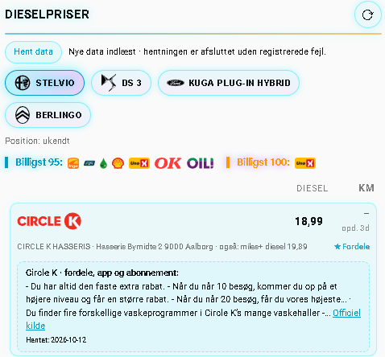
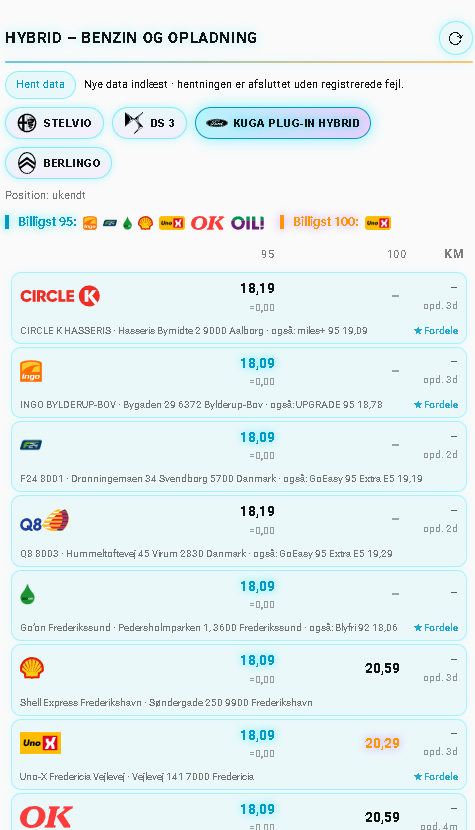
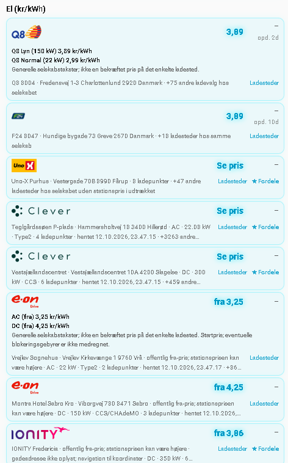
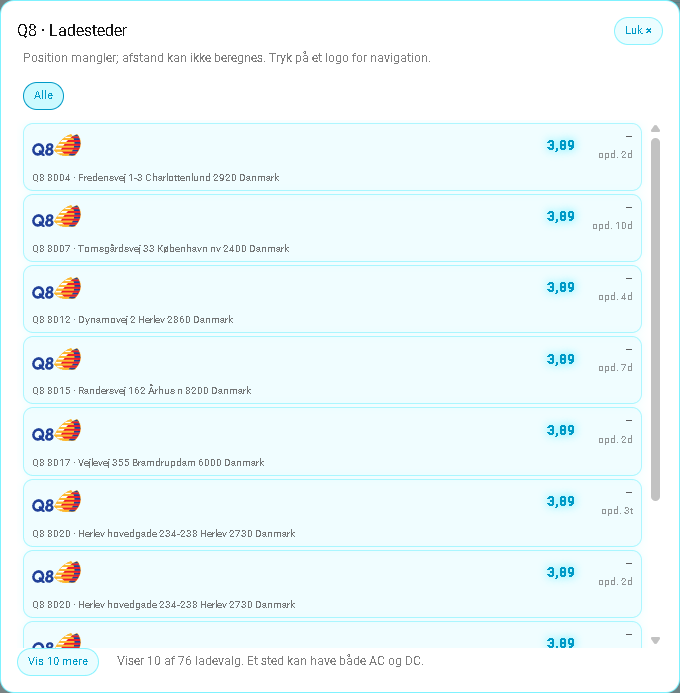
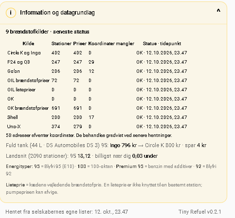
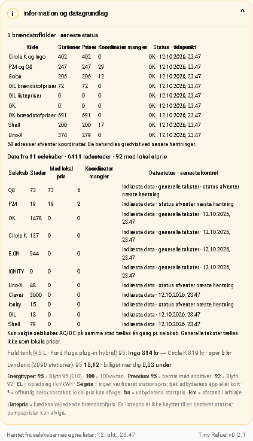
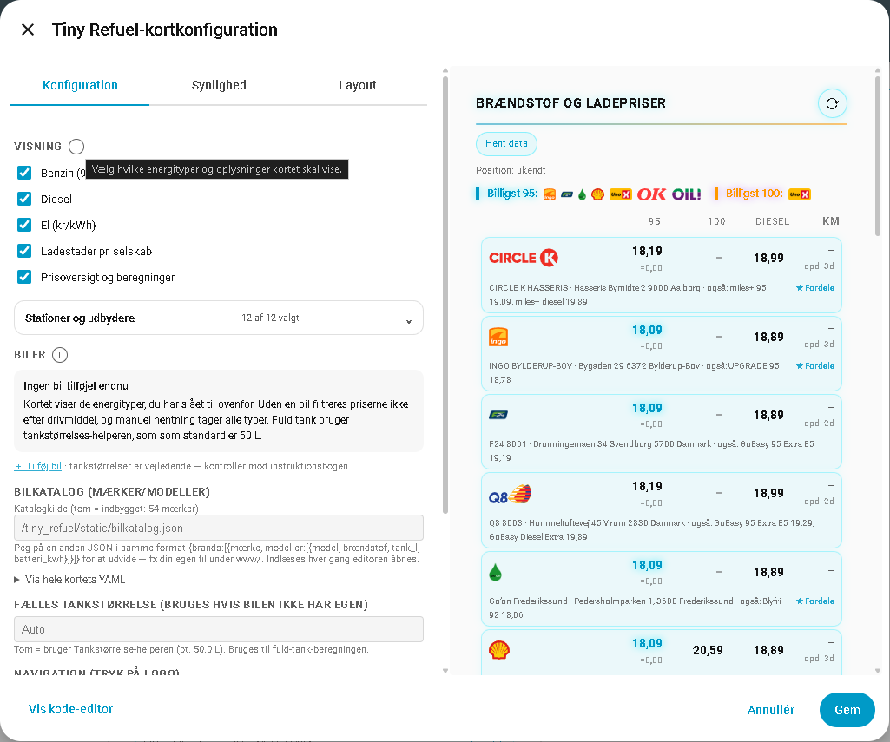
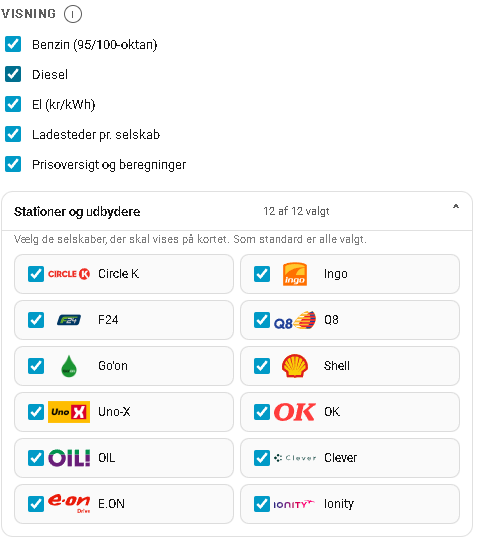
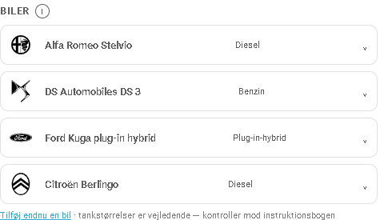
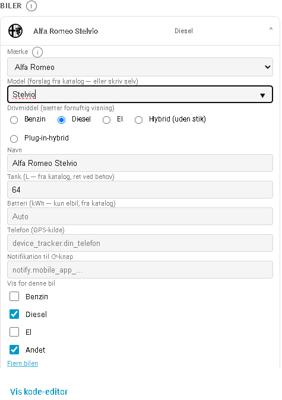

# Tiny Refuel v0.2.2

Benzin, diesel og opladning til køretøjer i Home Assistant. Tiny Refuel samler kort, visuel editor, selskabslogoer, køretøjskatalog og scraping i én HACS-integration.

## Installation

### HACS

Tiny Refuel kan installeres gennem [HACS](https://hacs.xyz/) (Home Assistant Community Store).

Brug knappen til at åbne Tiny Refuel direkte i HACS:

[](https://my.home-assistant.io/redirect/hacs_repository/?owner=Salvationdk&repository=tiny-refuel&category=integration)

*eller*

1. Installér HACS, hvis du ikke allerede har det.
2. Åbn HACS i Home Assistant.
3. Vælg **menuen med tre prikker → Brugerdefinerede repositories**.
4. Tilføj `https://github.com/Salvationdk/tiny-refuel` med typen **Integration**.
5. Søg efter **Tiny Refuel**, og tryk på **Download**.

### Opsætning efter download

1. Genstart Home Assistant.
2. Gå til **Indstillinger → Enheder og tjenester → Tilføj integration → Tiny Refuel**.
3. Vælg opdateringsinterval. Standard er hver 6. time.
4. Genindlæs browseren med **Ctrl+F5**.
5. Tilføj **Tiny Refuel** fra dashboardets kortvælger.
6. Vælg din positionsenhed, køretøjer og Waze eller Google Maps i den visuelle editor.

Kort, editor, selskabslogoer, køretøjskatalog og scraper følger med integrationen. Kortets JavaScript indlæses automatisk.

Kortet kan også tilføjes med YAML:

```yaml
type: custom:tiny-refuel-card
vis_benzin: true
vis_diesel: false
vis_el: true
vis_andet: true
```

Første scraping starter automatisk i baggrunden og kan tage flere minutter. **Hent data** i kortet eller integrationens knap starter en fælles opdatering.

Under hentning viser kortet den aktuelle udbyder og, når stationer eller adresser behandles enkeltvis, den aktuelle station/adresse. Status dækker benzin, diesel og el. Datastatus viser hver brændstofkilde, antal stationer og priser, manglende koordinater, seneste kontrol og eventuelle fejl. Eloversigten viser tilsvarende kilde- og koordinatstatus. Gamle priser markeres som gemte, når seneste hentning fejler. Adresser uden koordinater tælles og behandles gradvist ved senere hentninger.

Kortet bruger samme listevisning, uanset om skærmen står eller ligger. Hvert kort beholder logo, priser, adresse og afstand. Farver, kundefordele, filtre, navigation og knappen **Vis 10 mere** bevares. I UI-editoren kan hele kortets YAML vises og kopieres.

Hent-knappen kan skjules under punktet **Hent data** i UI-editoren. Her kan du også begrænse en manuel hentning til det valgte køretøjs drivmiddel. Et benzindrevet køretøj henter benzin, et dieseldrevet køretøj diesel, et elkøretøj el og en plug-in-hybrid både benzin og el. Slås begrænsningen fra, hentes alle typer. Automatisk intervalhentning henter fortsat alle typer, så nye køretøjer også får data. Data for fravalgte typer bevares mellem hentninger. Nogle brændstofkilder leverer benzin- og dieselpriser samlet, så de kan stadig blive hentet sammen.

Brændstof- og elladekilder er opdelt i hver sit provider-modul. Fordele, apps, medlemsordninger, rabatter og bilvask hentes fra relevante officielle sider hos hver udbyder, højst én gang om ugen. Kortet samler korte beskrivelser fra flere sider, når det er relevant, og viser den officielle kilde og hentetid. Kundeanmeldelser, citater og kommentarer sorteres fra, og cachede tekster genhentes, når filtreringen ændres. Hvis en side ikke kan læses, beholdes seneste gemte oplysninger.

Hvis kortet ikke findes efter genindlæsning, kan denne ressource tilføjes manuelt under dashboardets ressourcer med typen **JavaScript-modul**:

```text
/tiny_refuel/static/tiny-refuel-card.js?v=0.2.2
```

## Skærmbilleder

Skærmbilleder fra v0.2.1. Priser og datastatus er eksempler fra testtidspunktet. Position er ikke valgt i disse eksempler; afstande kræver en positionsenhed.

### Benzin, diesel og plug-in-hybrid

Det valgte køretøj bestemmer de viste energityper. En plug-in-hybrid viser både benzin og opladning. Køretøjsknapperne viser mærkelogo og model, når et logo findes, med tekst som fallback.

| Diesel og officielle kundefordele | Plug-in-hybrid: benzinoversigt |
|---|---|
|  |  |

### Opladning og ladesteder

Lokale priser, generelle selskabstakster og startpriser markeres forskelligt. **Se pris** betyder, at en verificeret stationspris ikke er tilgængelig i udtrækket. Dialogen **Ladesteder** viser selskabets ladevalg og giver mulighed for at vise flere.

| Ladeoversigt | Ladesteder pr. selskab |
|---|---|
|  |  |

### Information og datagrundlag

Den sammenklappelige informationsbjælke samler kildeoversigt, manglende koordinater, beregninger og forklaring af priser og energityper. Footer viser integrationens version.

| Benzin og beregninger | Brændstof og opladning samlet |
|---|---|
|  |  |

### Visuel editor

Editoren har tooltips, en samlet udbydervælger med logoer og en forklaring af visningen uden et oprettet køretøj.



| Udbydere med logoer | Sammenklappelige køretøjer |
|---|---|
|  |  |

Et køretøj kan udvides for at vælge mærke, model, drivmiddel, tank eller batteri, positionsenhed og hvilke energityper der skal vises. Det medfølgende katalog rummer 470 modeller og 22.604 variantposter fordelt på 54 mærker. Kun modeller med en kendt positiv tank- eller batteristørrelse medtages; motorredskaber og selvbyg er udeladt. En kapacitet på modelniveau bekræfter ikke alle årgange eller varianter. Egne køretøjer kan stadig indtastes manuelt. Ved mærke-/modelskift ryddes afhængige felter og tidligere automatisk dannede navne; selvvalgte navne bevares. Årstallet filtrerer varianter med kendte modelår og vælger kun automatisk, når alle varianter har årgangsdata og præcis én passer. Ellers vælges varianten manuelt.

Logopuljen er klargjort til 281 mærkenavne: 261 indlejrede SVG-logoer og 20 PNG-fallbacks. 16 SVG’er er gennemgåede vektoriseringer af rasterkilder, ikke originale vektorudgaver. Kilder og konverteringer er dokumenteret. Logoerne bruges i både editor og køretøjsknapper, også til manuelt indtastede køretøjer. Katalogets mærke- og modelfelter har søgning med højst 60 synlige forslag. Køretøjstype vælges manuelt og bruges ikke til at filtrere kataloget. Modelårsforslag gælder modellen samlet og bekræfter ikke en bestemt motorvariant. Se [logodokumentationen](docs/vehicle-logos.md).



## Funktioner

- Benzin, diesel og EL efter valgt køretøj.
- Hybrid uden stik viser benzin; plug-in-hybrid viser benzin og opladning.
- Adresser og nærmeste sted med afstand i luftlinje.
- Navigation gennem Waze eller Google Maps ved tryk på selskabets logo.
- **Ladesteder** pr. selskab med nærmeste først og relevante AC/DC/Normal/Hurtig/Lyn-filtre.
- 10 ladevalg ad gangen med mulighed for at vise flere.
- Q8 samlet i én EL-celle.
- Generelle OK/Q8-takster vises særskilt fra konkrete lokale priser.
- **Fordele** med vilkår, hvor der findes relevante oplysninger.
- Antal unikke ladesteder, selskaber og steder med konkret lokal elpris.
- Én opdateringshandling for alle kilder.
- Gentagne klik deler den igangværende hentning.
- Tre status-sensorer: antal ladesteder, antal steder med lokal elpris og seneste hentning.
- En fælles opdateringsknap og handlingen `tiny_refuel.refresh`.

AC og DC på samme sted tælles én gang pr. selskab. Generelle selskabstakster tæller ikke som lokale priser. Medlemsrabat trækkes ikke automatisk fra priserne.

## Fejl og rapportering

Åbne informations- og fejlfelter bevares ved automatiske opdateringer. Åbnes et andet informationsfelt, lukkes det foregående. Ladeoversigten bliver åben, indtil du trykker **Luk** eller åbner en anden ladeoversigt.

Fejloversigten viser også fejl ved hentning af officielle kundefordele og ved kontakt til integrationens data-API. Fordele hentes normalt højst én gang om ugen; tidligere brugbare oplysninger bevares ved kildefejl. Kortets afslutningsstatus tæller også fordelsfejl med.

HTTP 500 betyder en intern fejl hos den server, der besvarer kaldet. Udbyderfejl og fejl fra Home Assistants data-API vises med hver sin kilde. Offentlige GET-kald forsøges én gang igen efter en kort pause ved HTTP 500, 502, 503 eller 504. En vedvarende fejl vises stadig; genforsøget gælder ikke 403, 404 eller 429.

**Rapportér på GitHub** åbner et issueudkast med Tiny Refuel-version, kendte kildebetegnelser, fejlkategorier og HTTP-koder. Rå fejltekster, adresser, positioner, køretøjer og Home Assistant-konfiguration indsættes ikke i udkastet. Brugeren gennemser og indsender selv; GitHub beder om login, hvis nødvendigt. Integrationens kode registrerer ikke, om brugeren allerede er logget ind på GitHub.

## Datakilder

Kun frit tilgængelige kilder uden betalt eller registreret API-adgang bruges.

| Selskab | Oplysninger fra anvendt kilde |
|---|---|
| Circle K / INGO | Offentlige brændstofpriser; Circle K også danske ladesteder, stiktyper, effekt og daglig listepris for lynladning |
| Q8 / F24 | Stationspriser inklusive HPC, når oplyst; Q8's generelle ladetakster vises særskilt |
| Go'on / Shell / Uno-X | Offentlige brændstofkilder; Shell og Uno-X også ladesteder |
| OK / OIL | Lokale brændstofpriser og ladeadresser; generelle OK-ladetakster særskilt |
| Clever | Ladesteder, adresser, koordinater og AC/DC/effekt, når oplyst. Prisen varierer pr. sted og tidspunkt og skal ses i Clever-appen/kortet |
| E.ON | Ladesteder, adresser, koordinater og AC/DC/effekt, når oplyst; offentlige danske startpriser vises som generelle takster |
| IONITY | Aktive danske steder, koordinater og effekt/antal, når oplyst; ingen gadeadresse i udtrækket. Offentlige minimumspriser for app, direkte betaling og abonnement vises særskilt |

Ved vellykket hentning erstattes selskabets tidligere liste. Ved kildefejl bevares eventuelle tidligere data fra denne installation, tydeligt markeret som gemte data.

En downloaddato er ikke en garanti for selskabets egen kontroltid. En hentning kan give data fra nogle selskaber og fejl fra andre; fejlene vises i kortet.

Adressekoordinater, der ikke findes i selskabets kilde, kan slås op med Nominatim, maksimalt 30 nye adresser pr. kørsel samlet for brændstof- og ladestationer i de hentede drivmidler. Det er stationsadresser, ikke din GPS-position.

Under **Information og datagrundlag** skelnes mellem unikke adresser klar til opslag, adresser søgt uden resultat og stationer uden en adresse at søge på. Seneste kørsel viser forsøg, fund, manglende resultater og fejl. De konkrete adresser og første mulige genforsøg vises i en liste. Adresser uden søgeresultat prøves tidligst igen efter syv dage; netværksfejl stopper resten af kørslen. Der loves ikke en slutdato, da udbydernes oplysninger og søgeresultater kan mangle. Visningen bliver detaljeret efter første hentning med denne version. Koordinatopslag finder koordinater fra en adresse; der foretages ikke automatisk opslag af gadenavne fra koordinater.

Din valgte telefonposition bruges i browseren til afstande. Den ønskede destination sendes til Waze eller Google Maps ved navigation.

## Filer og opdateringer

HACS installerer kode og medfølgende aktiver under:

```text
custom_components/tiny_refuel/
```

Genererede prisdata, ny historik og koordinatcacher gemmes privat under:

```text
.storage/tiny_refuel/
```

Disse data overlever kodeopdateringer. Scraping ændrer ikke HACS' kodefiler. Data til kortet leveres gennem en Home Assistant-API, der kræver login.

Køretøjskatalog og standardlogoer ligger under integrationens `frontend/`. Direkte ændringer dér kan blive overskrevet af en HACS-opdatering. Eget køretøjskatalog kan vælges med en brugerdefineret URL i korteditoren.

Efter en opdatering gennem HACS: genstart Home Assistant, og genindlæs browseren.

### Ren start

1. Fjern integrationen under **Enheder og tjenester**.
2. Slet kun mappen `.storage/tiny_refuel/`, mens integrationen er stoppet.
3. Tilføj integrationen igen.

HACS-afinstallation eller fjernelse af integrationen sletter ikke automatisk de gemte data.

## Udvikling og test

Minimum Home Assistant: **2025.11.2**.

Automatiske tests bestået med Home Assistant **2026.10.0**.

Teknisk integrationsversion: **0.2.2**. Kortets footer viser integrationsversionen, mens overskriften fortsat viser den valgte brændstof- eller energitype. Kortets hovedfil hedder `tiny-refuel-card.js`; versionsnummeret tilføjes URL’en som `?v=0.2.2` for at opdatere browserens cache. Det tidligere filnavn `tiny-refuel-card-v0.1.js` bevares som en lille kompatibilitetsfil, der indlæser hovedfilen, så eksisterende manuelle ressourcer fortsat virker.

GitHub Actions kører integrations- og frontendtests samt HACS-validering. Workflowet er sat til Home Assistant **2026.10.0**.

```bash
python -m unittest discover -s tests -v
node tests/frontend.test.js
```

Automatiske tests dækker ikke hele den visuelle brugeroplevelse, telefonnavigation eller selskabernes fortsatte datatilgængelighed.


### Vedligeholdelse af køretøjskataloget

Kataloget indeholder også ældre benzin- og dieselmodeller samt større køretøjer og varevogne. Modelnavne og tekniske specifikationer behandles hver for sig. De 175 nye navne i 0.2.2 har kildelinks, men ingen gættede tank-, batteri- eller drivmiddelværdier. Eksisterende poster og egne kataloger bevares.

Et udviklerværktøj kan hente modelnavne fra Toyota Danmarks officielle, strukturerede modeloversigt. Det skriver en kandidatliste til gennemgang og ændrer ikke integrationens katalog automatisk. Det kører ikke ved almindelig pris-scraping. Flere producentadaptere kan tilføjes senere; den første dækker Toyota, ikke alle mærker.

```bash
python scripts/vehicle_catalog.py scrape --source toyota-dk --output /tmp/toyota-models.json
# Gennemgå navnene og sæt reviewed til true i kandidatfilen.
python scripts/vehicle_catalog.py merge --input /tmp/toyota-models.json
# Tilføj --write for at gemme efter gennemgang.
```

Uden --write viser importen kun, hvilke navne der ville blive tilføjet. Kendte poster, logoer, tankstørrelser og brugerdata overskrives ikke. De gennemgåede tilføjelser ligger i scripts/data/vehicle-model-additions-2026-10.json.

### Dansk registerkatalog og lokal modelsøgning

Køretøjsoprettelsen bruger det medfølgende katalog: vælg fabrikant, søg model og vælg selv drivmiddel samt eventuelt årgang/variant. Der hentes ikke modeldata fra eksterne sider under oprettelsen. Ændres årgang/variant, ryddes modelstandarderne for drivmiddel, tank og batteri, så de kan bekræftes for den konkrete variant. Højst 60 modelforslag vises ad gangen; skriv mere for at indsnævre. Egne modeller og egne JSON-kataloger kan stadig bruges.

Motorstyrelsens gratis statistikudtræk er hovedkilden til den nye importfunktion. Den læser personbiler/busser, varebiler og lastbiler (DMR-art 1–4) samt genkendte navngivne motorkøretøjstyper, bl.a. motorcykler, knallerter og traktorer, fra en hentet XML- eller ZIP-fil. Ukendte typer medtages ikke automatisk. Mærker, modeller og variantnavne samles uden gentagelser. Rå tekniske kombinationer gemmes separat som `dmr_profiles`; de bruges endnu ikke som bekræftede specifikationer i kortet. Eksisterende modelværdier og logoer bevares. Ukendte mærker har tekstfallback. Nummerplader, stelnumre og køretøjs-ID'er eksporteres ikke til kataloget. Årgang og tank-/batteristørrelse udledes ikke af første registrering eller modelnavnet.

**Status:** Udtrækket fra 2026-10-07 er importeret og renset. Det medfølgende udvalg er derefter begrænset til 470 modeller med kendt tank-/batteristørrelse; 26.772 modelrækker uden kapacitet er udeladt. Originalens importtal bevares som historik; de aktuelle tal står i `capacity_filter`. Rå tekniske profiler ligger uden for kortet. Kataloget indlæses én gang pr. URL i browserens aktuelle session og deles mellem kort og editor. Modelværdier kræver fortsat kontrol for det konkrete køretøj.

Kilde og gratis adgang: [Motorstyrelsen – statistikudtræk](https://motorst.dk/erhverv/motorregistret-for-virksomheder/faa-adgang-til-motorregistret/andre-adgange). Udtrækket er stort og behandles uden for Home Assistant.

Når workflowet er tilgængeligt på standardbranchen, kan vedligeholderen åbne **Actions → Build Danish vehicle catalog → Run workflow**. Kørslen henter den seneste officielle fil, læser den uden at pakke den store XML ud på disk og leverer et lille katalogforslag samt en importstatus som artifact. Den ændrer ikke repository eller udgiver noget automatisk. FTP-serveren kan være utilgængelig; en mislykket import erstatter ikke det medfølgende katalog.

Alternativt kan importen køres lokalt:

```bash
python scripts/dmr_catalog.py download --output /tmp/dmr.zip
python scripts/dmr_catalog.py build --input /tmp/dmr.zip --source-date YYYY-MM-DD --output /tmp/bilkatalog-candidate.json --report /tmp/dmr-import-report.json
```

Brug datoen i det officielle filnavn som source-date. Gennemgå status, dubletter og nye mærker, og læg derefter det godkendte katalog i integrationens frontend/bilkatalog.json før udgivelse. Kildefilen er ikke en del af integrationen.

Byg et katalog med unikke modelrækker, bevarede varianter og rapport over sammenlægninger: se [vejledningen til modelimport](docs/unique-vehicle-models.md). Prøver kan køres med `build --limit 100000`; eksisterende JSON-kataloger kan kontrolleres med `deduplicate`.

Grundkataloget indeholder det kapacitetsfiltrerede udvalg og de bevarede 261 SVG- og 20 PNG-logoer. Årgangslister, variantnavne, drivmidler og kildemetadata til modellen hentes fra `catalog-details/`, når modellen vælges i editoren. Samme detaljefil deles mellem editorer; en fejl stopper ikke manuel indtastning. Detaljesvar ændrer ikke gemt konfiguration eller igangværende indtastning. Gentagne kildelinks og hjælpetekster gemmes én gang som fælles standardværdier.

Kataloget distribueres som `bilkatalog.json` med en liste af mindre filer under `catalog-parts/`. Kortet samler dem uden tab med højst fire samtidige hentninger. Alle dele skal være tilgængelige, før kataloget vises. Egne almindelige JSON-kataloger understøttes fortsat. Nye kataloger kan pakkes med `python scripts/package_vehicle_catalog.py INPUT.json custom_components/tiny_refuel/frontend/bilkatalog.json`.


### Kompakt kort

Slå **Kompakt kort** til i den visuelle editor for et mindre kort med færre
oversigter. Standardvisningen er uændret, indtil valget aktiveres.

```yaml
type: custom:tiny-refuel-card
kompakt: true
antal_stationer: 3
vis_bilvaelger: false
```

Behold `biler` fra din eksisterende opsætning. Ved ét køretøj er køretøjsvælgeren
skjult som standard i kompakt visning; ved flere køretøjer bevares den altid.
`vis_bilvaelger: true` viser også vælgeren ved ét køretøj.

`antal_stationer` begrænser rækkerne i hver prisliste. Brændstof viser én række
pr. selskab; eloversigten viser grupper af ladevalg. Derfor er antallet ikke
et samlet antal fysiske stationer. Gyldige værdier er 0–50; 0 viser alle,
og et tomt felt bruger standarden (3 i kompakt visning, alle i normal visning).
**Vis 10 mere** udvider kun den pågældende liste. Den særskilte ladeoversigt
beholder sine filtre og sit eget antal. Kompakte brændstofrækker vises med
nærmeste kendte afstand først, når position er tilgængelig.

Navigation, adresser, prisadvarsler, fejl og datastatus bevares. Information
og beregninger kan åbnes i **Information og datagrundlag**. Positionsteksten,
billigste-oversigten og prisændringer fylder mindre eller skjules i kompakt
visning. **Hent data** er skjult som standard i kompakt visning, men kan
aktiveres med `vis_scrape_knap: true`. En igangværende hentnings status vises stadig.

Teksterne bruger **køretøj**, fordi kataloget også omfatter motorcykler, knallerter, lastbiler og traktorer. YAML-nøglerne `biler`, `vis_bilvaelger` og `scrape_valgt_bil` bevares af hensyn til eksisterende opsætninger.

### Manglende tank, drivmiddel eller batteri

[Scrapervejledning](docs/vehicle-spec-scraper.md): `scripts/scrape_vehicle_specs.py` laver en mangelliste fra det ufiltrerede originalkatalog og læser kandidater fra angivne kildesiders strukturerede køretøjsdata. Forslag gemmes med kilde, år/variant og krav om gennemgang. Scriptet ændrer ikke kataloget automatisk. `scripts/build_supported_catalog.py` kan bagefter bygge det medfølgende udvalg fra et gennemgået fuldt katalog.

Kompakt visning viser også billigste brændstofpris blandt alle valgte selskaber, inklusive rækker skjult af visningsgrænsen. Vis færre gendanner grænsen efter Vis 10 mere i begge oversigter og i ladepopup'en. En laveste oplyst elpris kan være en generel takst og er ikke en garanti for den lokale pris på et ladested.
